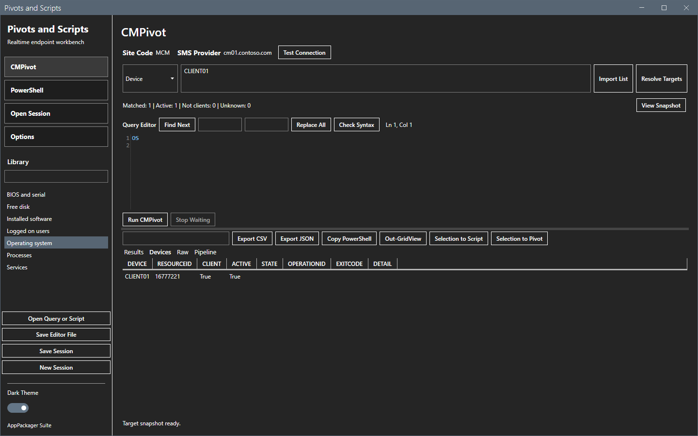
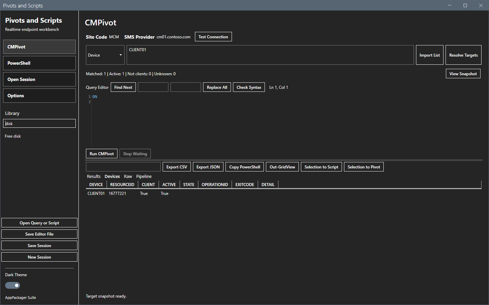
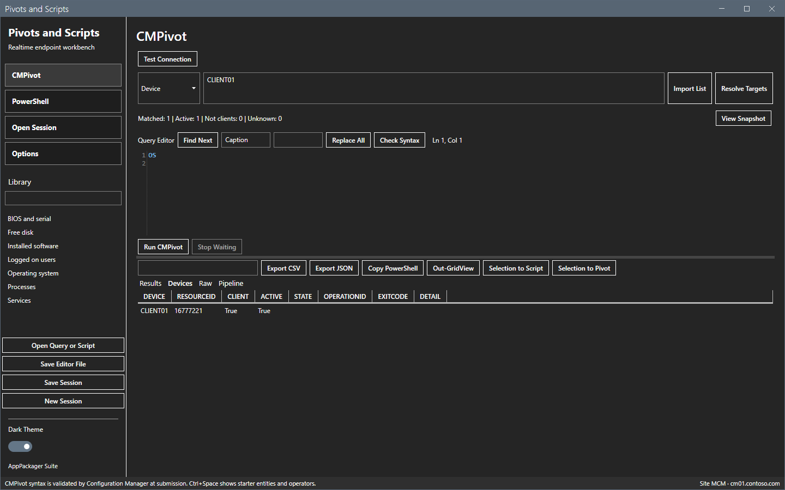
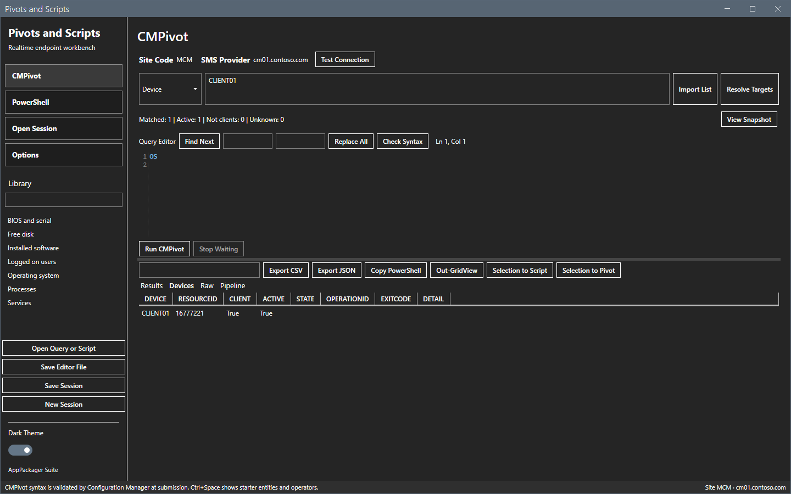
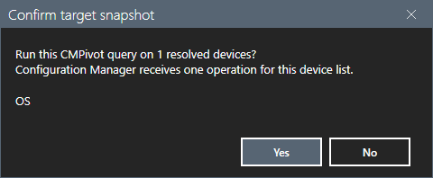
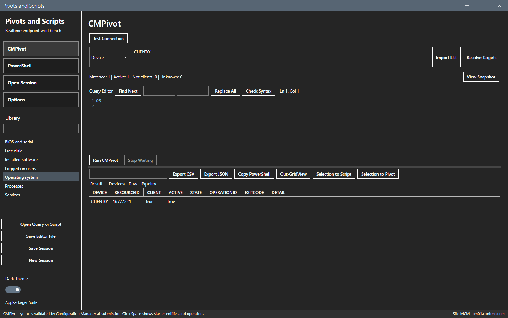
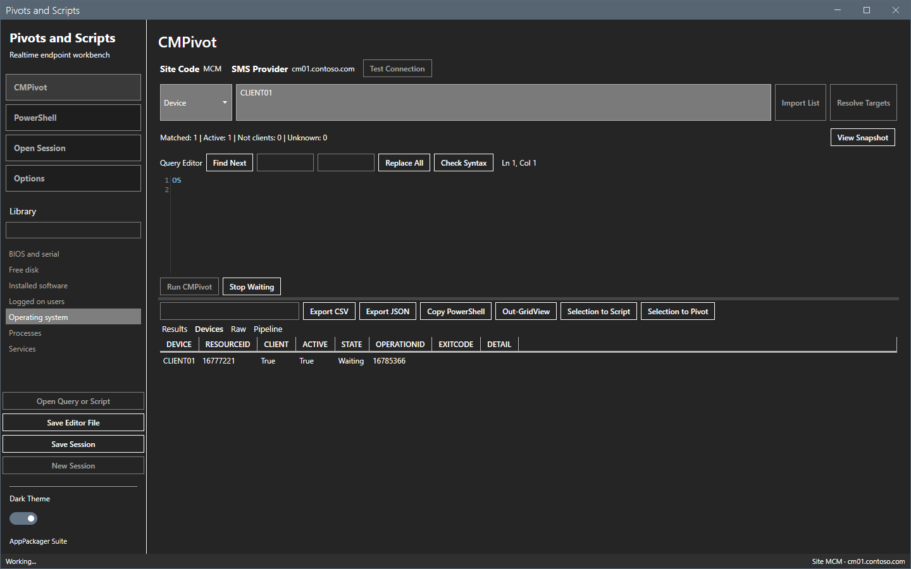

# CMPivot

The CMPivot view sends one CMPivot query to the resolved devices and shows the answers as each device replies.

## What it does

CMPivot reads the live state of devices through the Configuration Manager client. The tool sends your query as one operation and reads the results of all devices with one request every 3 seconds.

## When to use it

Use it for a question about the current state of many devices, for example the operating system, the free disk space or the running processes.

## Requirements

- Resolved targets. See [Targets](targets.md).
- The computer trusts the certificate of the SMS Provider, because CMPivot uses the administration service over HTTPS. See [Network](../reference/network.md).
- The rights **Run CMPivot** on the collection and **Read** on **Inventory Reports**. See [Permissions](../reference/permissions.md).

## Steps

### Open a query from the library

1. Select **CMPivot** in the sidebar.
2. Double-click a query in the **Library** list. The text shows in the editor.

3. To find a query, type part of its name in the box above the list.

The library holds the files of the `Library\Pivots` folder. **Open Query or Script** opens any `.cmpivot` or `.kql` file. **Save Editor File** saves the text as a `.cmpivot` file.

### Edit the query

1. Type the query in the editor. **Ctrl+Space** shows a starter list of entities and operators.
2. Type text in the first box and select **Find Next** to find it. Type a second text and select **Replace All** to replace every match.

3. Select **Check Syntax**. For CMPivot, the tool does not check the query. Configuration Manager does that at the run.

### Run the query

1. Select **Run CMPivot**. A confirmation with the title `Confirm Target Snapshot` lists the number of resolved devices, the scope and the query.

2. Select **No** to stop. Nothing is sent.

3. Select **Yes** to send the query.

The status line shows `Working...`. **Stop Waiting** becomes active. The sidebar and the target controls stay disabled until the run ends.

When all devices have answered, the status line shows `Completed.` with the number of rows and device statuses. See [Results](results.md).

## Options and settings of this page

| Control | Effect |
|---|---|
| **Run CMPivot** | Asks for confirmation, then sends the query. |
| **Stop Waiting** | Stops the local wait. See Limits. |
| **Check Syntax** | Shows a note. CMPivot checks the query at the run. |
| Find box, Replace box | Find and replace text in the editor. |

## Limits

- A run is one operation for the whole target list, or for the whole collection.
- **Stop Waiting** stops only the wait in the tool. Operations that the site already received can still run on the devices.
- A device without a result after 300 seconds shows **No response within timeout**. The device can still run the operation.
- The administration service returns HTTP 400 without a reason for an invalid query. The device detail then says to check the query syntax.
- The tool shows the results of one run. A new run replaces them. The session keeps every run.

## Troubleshooting

| Message or symptom | Cause | Fix |
|---|---|---|
| `Select Resolve Targets first.` | No snapshot exists. | Select **Resolve Targets**. |
| `The editor is empty.` | The editor has no text. | Type or open a query. |
| A device shows `Query failed`. | The query has an error, or the device refused it. | Read the detail on the **Devices** tab. Check the syntax. |
| A device shows `Not a client`. | The device has no Configuration Manager client. | Install the client, or remove the device. |
| The run ends at once with a trust error. | The computer does not trust the provider certificate. | See [Network](../reference/network.md). |

## Links

- [Results](results.md)
- [Targets](targets.md)
