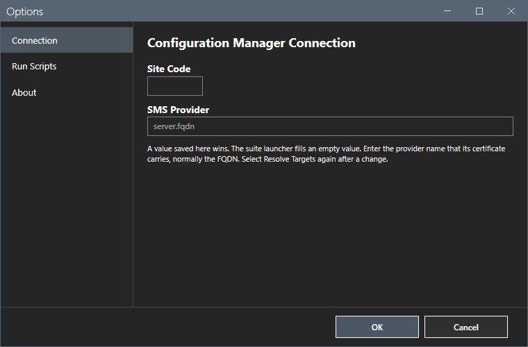
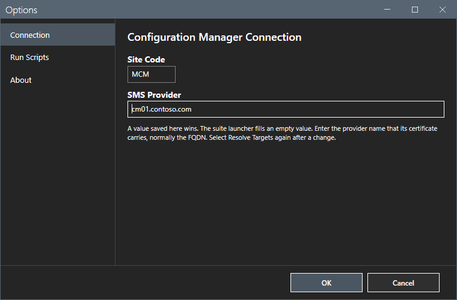
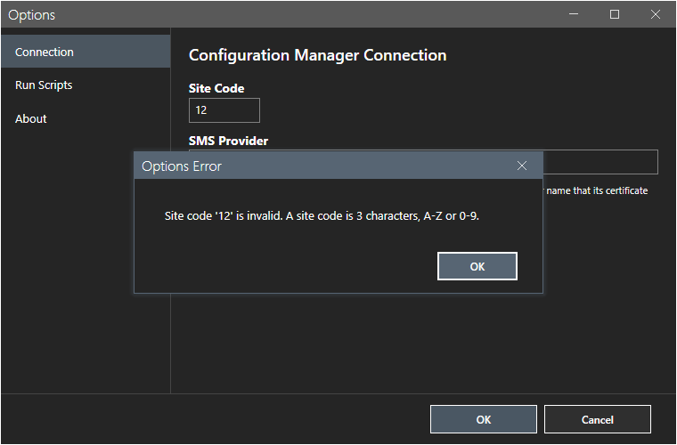
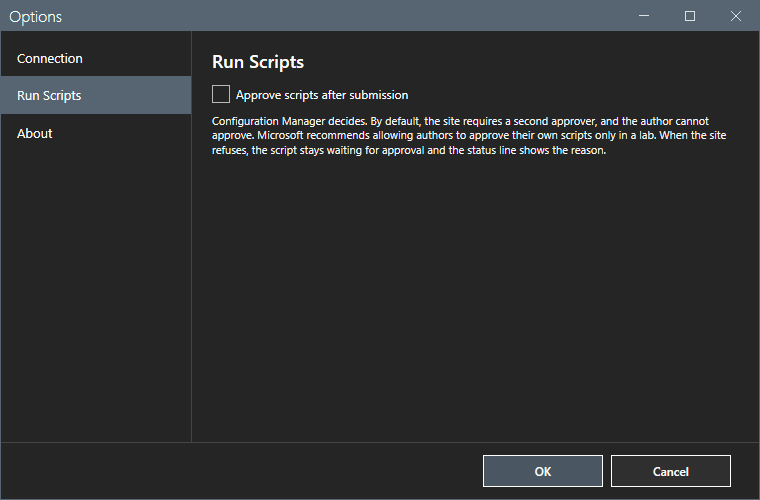
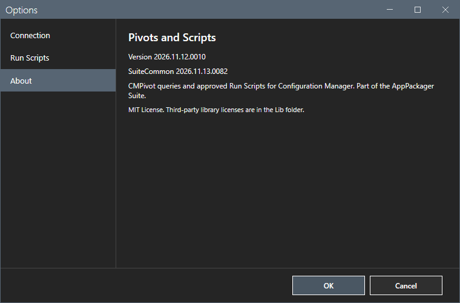
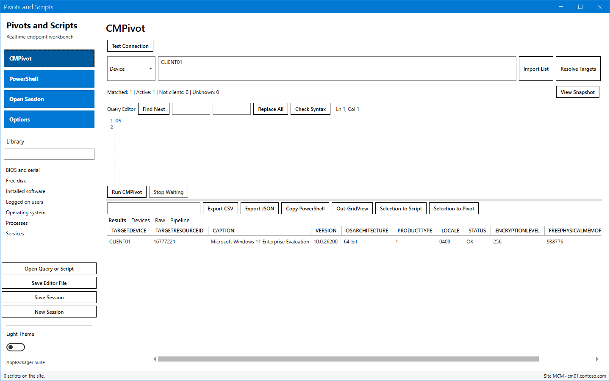
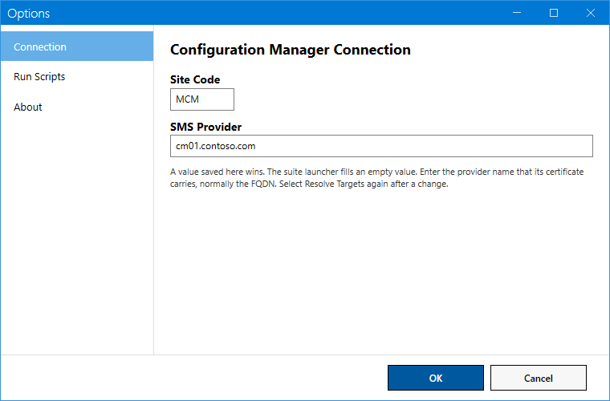

# Options dialog

The Options dialog sets the connection and the approval rule, and shows the version of the tool.

## What it does

The dialog has three pages: **Connection**, **Run Scripts** and **About**. **OK** saves the settings. **Cancel** closes the dialog without a change.

## When to use it

Use it at the first start, when the site or the provider changes, and to read the version.

## Requirements

None.

## Steps

### Set the connection

1. Select **Options** in the sidebar. The **Connection** page shows.

2. Type the **Site Code** and the **SMS Provider**. The two titles are bold 14 pt in both themes. The value boxes use normal text. These two boxes are the only place where you change the connection. The footer shows the saved values as read-only text.

3. Select **OK**. A site code that does not have 3 characters of A to Z or 0 to 9 gives a message, and the dialog stays open.

A value that you saved wins. The suite launcher fills an empty value through the variables `SUITE_CM_SITECODE` and `SUITE_CM_PROVIDER`. The command-line parameters `-SiteCode` and `-SMSProvider` override both for one session.

### Set the approval rule

1. Select **Run Scripts**.
2. Select or clear **Approve scripts after submission**. The default is off.

The setting works only where the site lets authors approve their own scripts. Microsoft recommends that site setting only for a lab. When the site refuses, the script stays waiting for approval and the status line shows the reason.

### Read the version

Select **About**. The page shows the version of the tool and of the shared module, and the license note.

### Switch the theme

Use the switch at the bottom of the sidebar. The label shows **Dark Theme** or **Light Theme**. The dialogs follow the theme. The light theme and the dark theme differ in colors only. Every blue box has white text in both themes. The tool does not save the theme: every start uses the dark theme.

## Options and settings of this page

| Setting | Effect | Default |
|---|---|---|
| Site Code | The 3-character site code. | Empty |
| SMS Provider | The host name of the SMS Provider, without a URL or a path. | Empty |
| Approve scripts after submission | Approves each new script right after **Submit Script for Approval**. | Off |
| Theme | Dark or light. The tool does not save it. | Dark |

## Limits

- The provider name must be a host name or an FQDN. A URL or a path gives a message.
- After you change the connection, resolve the targets again.

## Troubleshooting

| Message or symptom | Cause | Fix |
|---|---|---|
| `Site code '<value>' is invalid. A site code is 3 characters, A-Z or 0-9.` | The site code has the wrong form. | Type a valid site code. |
| `SMS Provider '<value>' is invalid. Enter a host name or FQDN without a URL or path.` | The provider has a URL or a path. | Type the host name. |
| `The options could not be saved to <path>.` | The tool cannot write its data folder. | Check the rights. |

## Links

- [Getting started](../getting-started.md)
- [Settings](../reference/settings.md)
