# Results

The result area shows the answers of the last run on four tabs. You can filter, export and copy the rows, and send selected devices to the next step.

## What it does

The **Results** tab has one row for each result, with the columns `TargetDevice` and `TargetResourceID`. The **Devices** tab has one row for each device with its state. The **Raw** tab shows the records that the site returned. The **Pipeline** tab lists each step of the session.

## When to use it

Use it to read the answers of a run, to hand them to someone else, and to narrow a check to the devices that matter.

## Requirements

A finished run. See [CMPivot](cmpivot.md) or [Run Scripts](run-scripts.md).

## Steps

### Read the tabs

1. Select **Results**. Each row is one answer. You can sort a column, reorder the columns and select several rows.

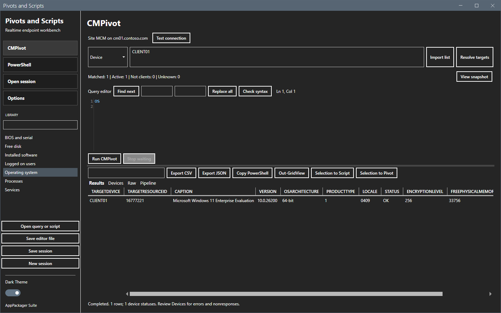

2. Select **Devices**. The columns are `Device`, `ResourceID`, `Client`, `Active`, `State`, `OperationID`, `ExitCode` and `Detail`. The state `Response received` means that the device answered.

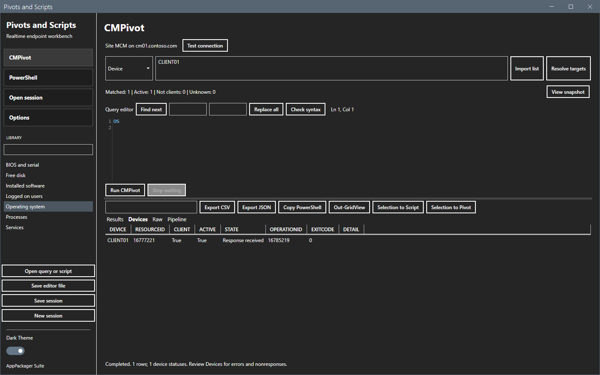

3. Select **Raw**. It shows the submit record and one result record for each device.

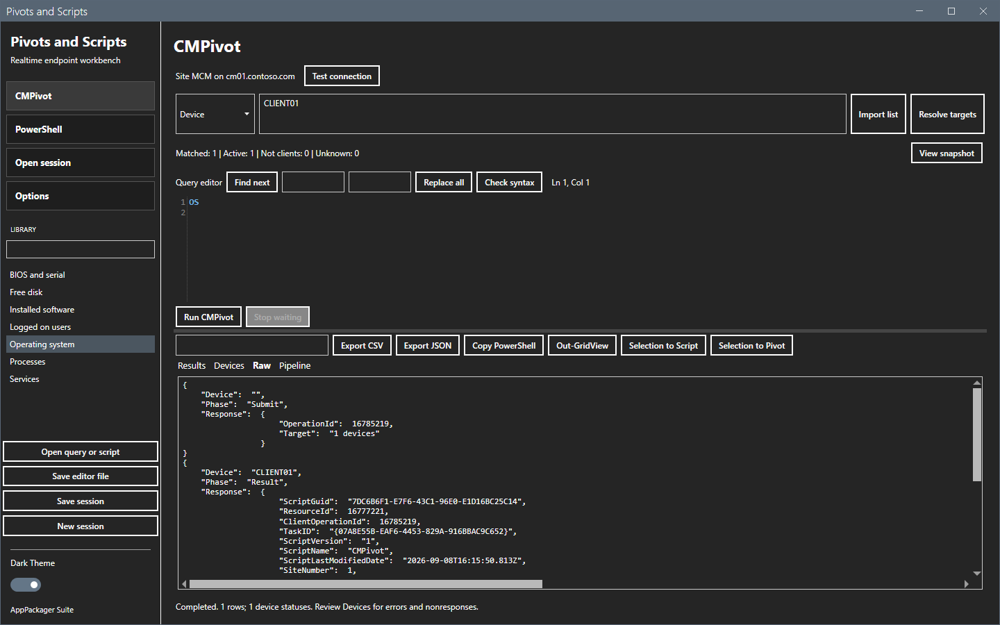

4. Select **Pipeline**. Each row is one step: the number, the mode, the start time, the state and the counts.

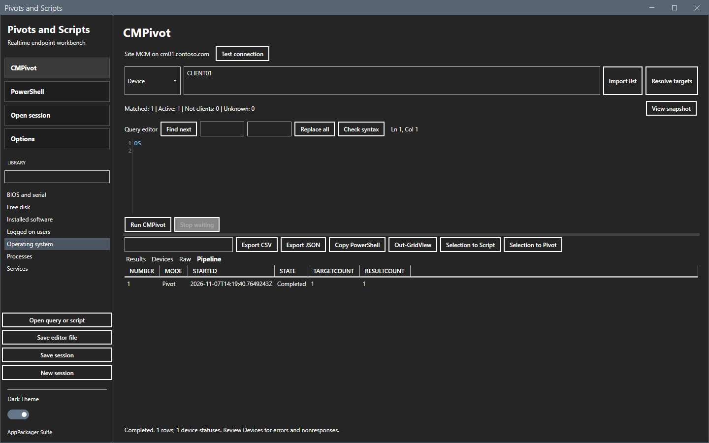

### Filter the rows

Type text in the box above the grid. The grid keeps the rows that contain the text in any column.

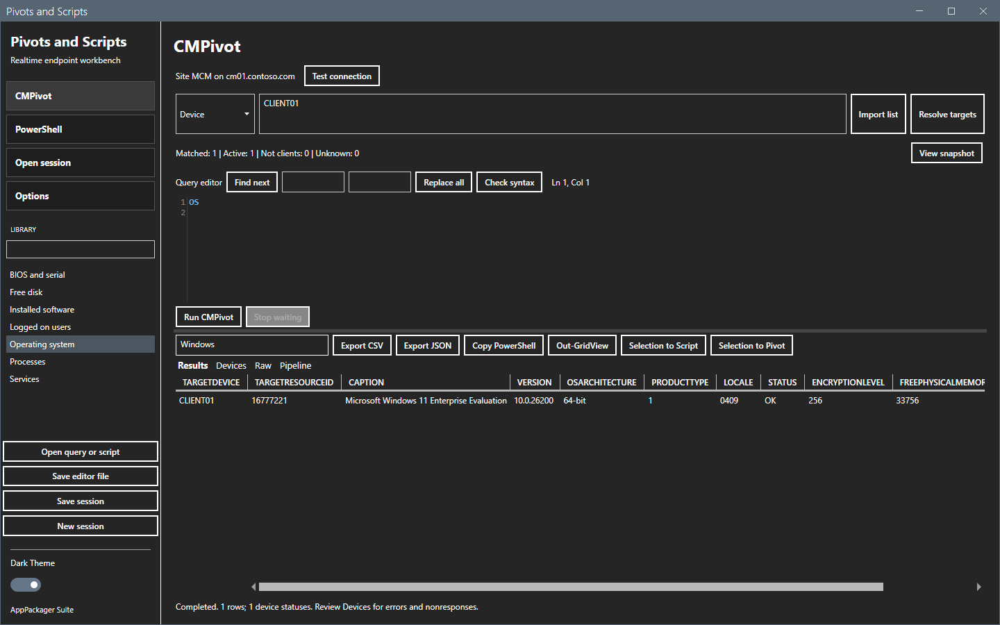

### Export or copy the rows

The buttons use the rows that the filter shows.

1. Select **Export CSV**. In the Save As dialog, pick a folder and a name, and select **Save**.

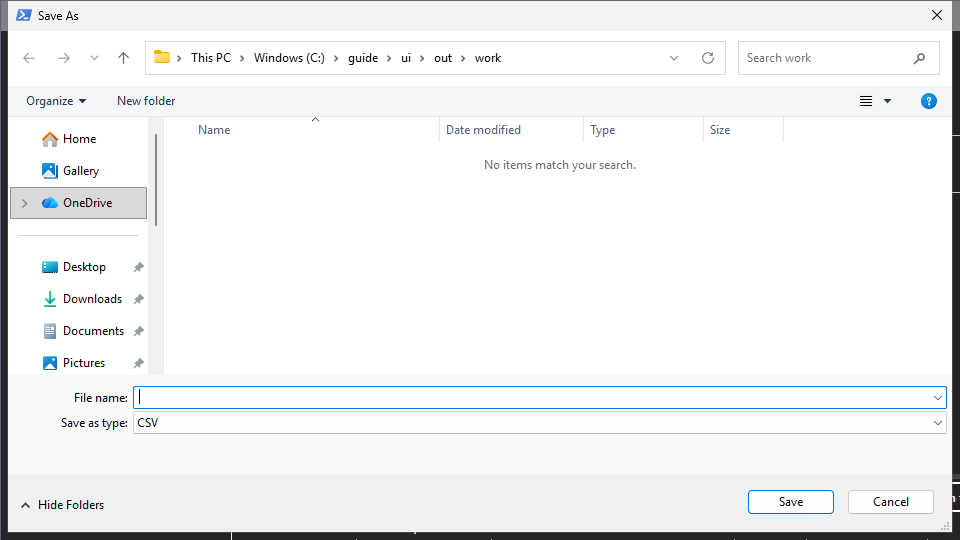

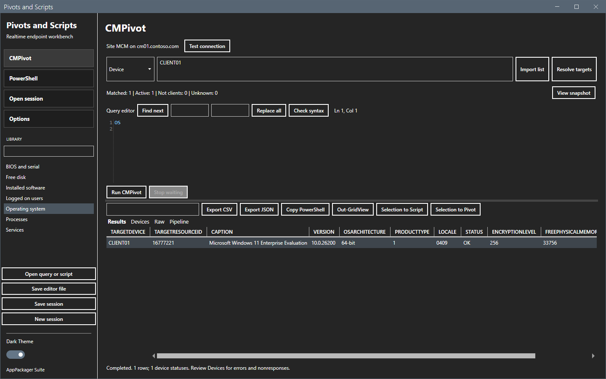

2. Select **Export JSON** for a JSON file.
3. Select **Copy PowerShell**. The clipboard gets one command that rebuilds the objects. The status line shows the number of rows.

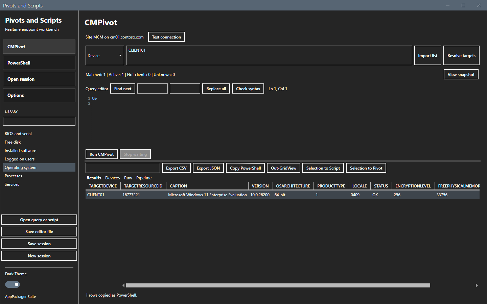

4. Select **Out-GridView** to open the rows in a separate window. Close the window when you are done.

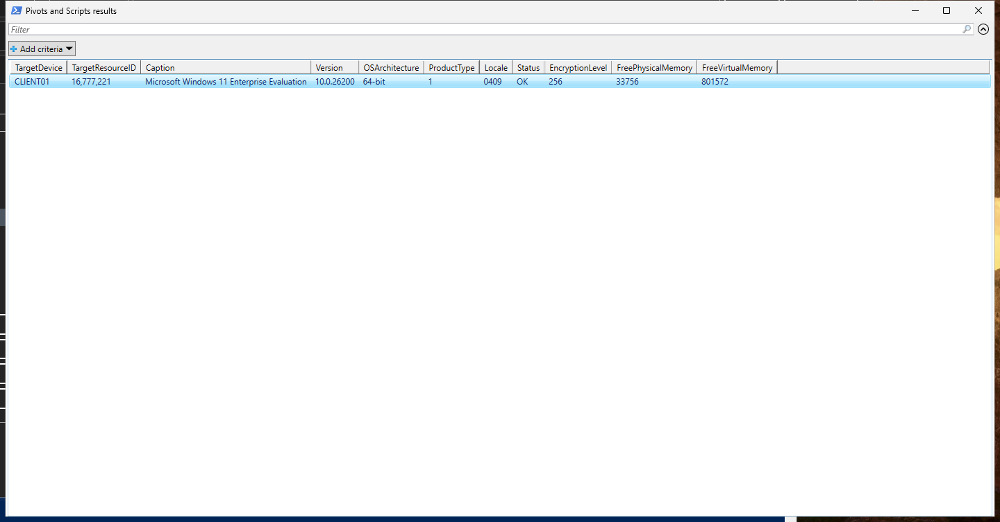

A CSV value that starts with `=`, `+`, `-` or `@` gets a single quote in front of it, so that a spreadsheet does not run it as a formula.

### Send devices to the next step

1. Select one or more rows in **Results**.

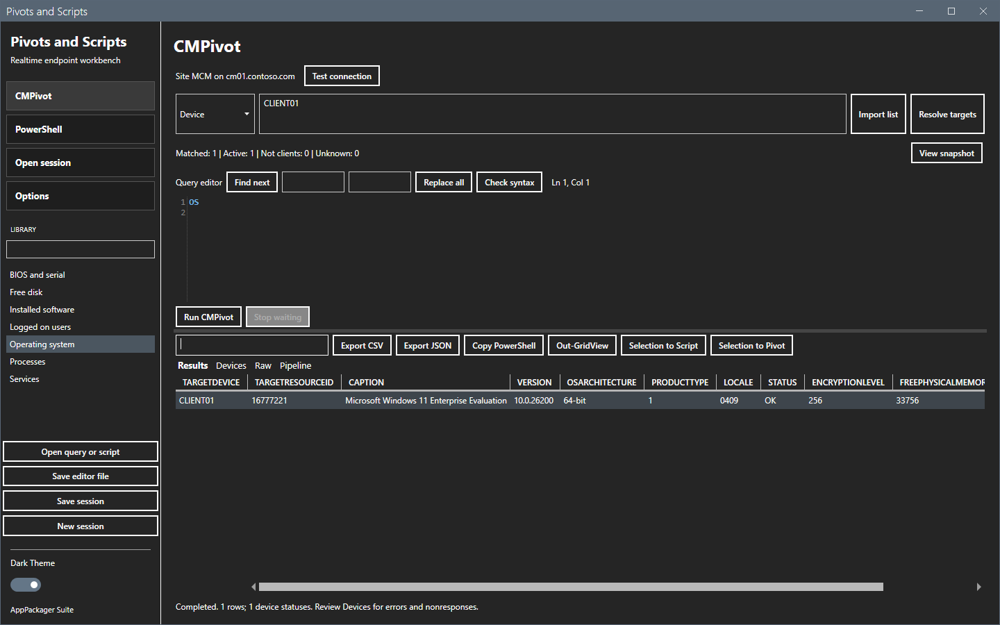

2. Select **Selection to Pivot** or **Selection to Script**. The targets are then only those devices, and the line under the target box says `<n> devices selected from previous results.` The view changes to the chosen mode, and the editor, the parameters and the script GUID are cleared.

Without a selected row, a message says to select rows first.

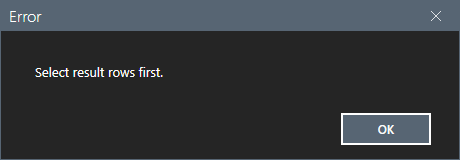

## Options and settings of this page

| Control | Effect |
|---|---|
| Filter box | Keeps the rows that match the text. |
| **Export CSV**, **Export JSON** | Write the shown rows to a file. |
| **Copy PowerShell** | Copies a command that rebuilds the rows. |
| **Out-GridView** | Opens the rows in a window. |
| **Selection to Script**, **Selection to Pivot** | Use the devices of the selected rows as the next targets. |

## Limits

- Script output is limited to 4 KB for each device. The tool splits JSON output into columns.
- The columns are the columns of the query. A new query has its own columns.
- A button that needs rows gives a message when the grid is empty: `There are no results to export.`, `There are no results to copy.` or `There are no results to show.`
- Results of another connection cannot become targets: `Results belong to another connection. Restore that connection before selecting targets.`

## Troubleshooting

| Message or symptom | Cause | Fix |
|---|---|---|
| A device shows `No response within timeout`. | No result arrived in 300 seconds. | Run again later. The device can still run the operation. |
| A device shows `Result error`. | The tool could not read the result page. | Read the detail. Check the connection. |
| A device shows `Query failed` or `Script failed`. | The query or the script failed on the device. | Read the exit code and the detail. |
| A device shows `Stopped waiting`. | You selected **Stop waiting**. | Run again if you need the answer. |

## Links

- [Sessions](sessions.md)
- [CMPivot](cmpivot.md)
