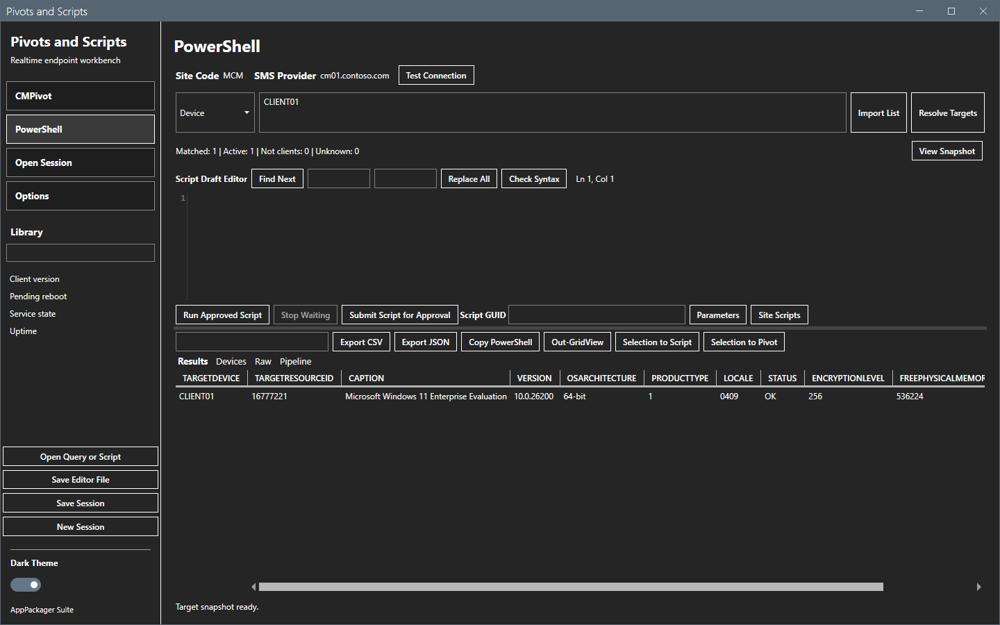
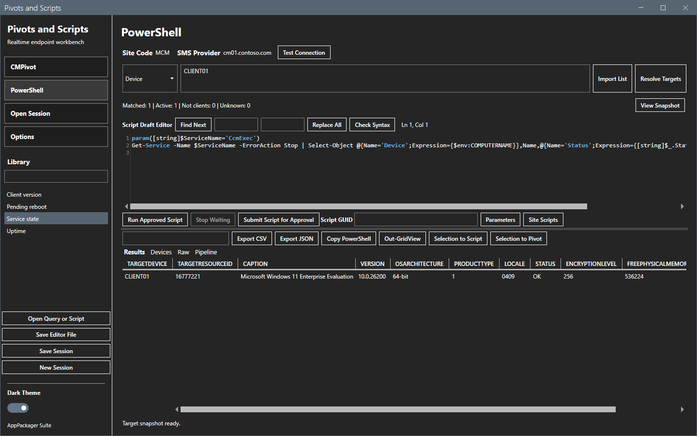
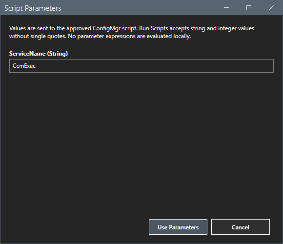
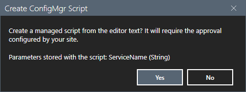
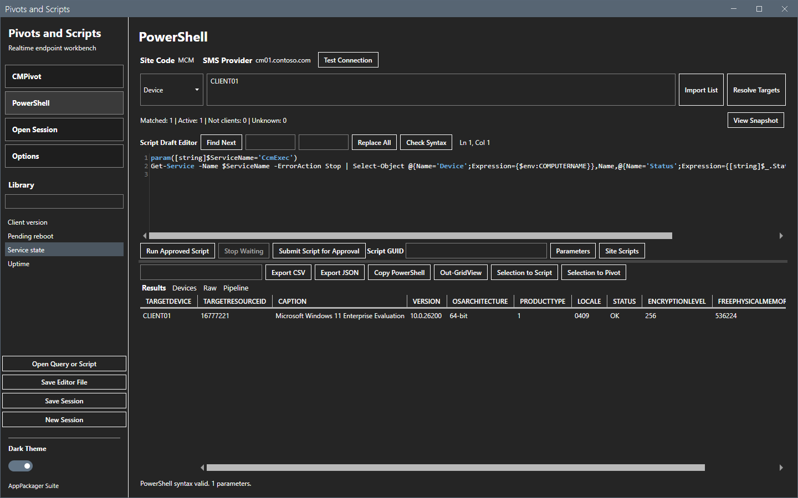
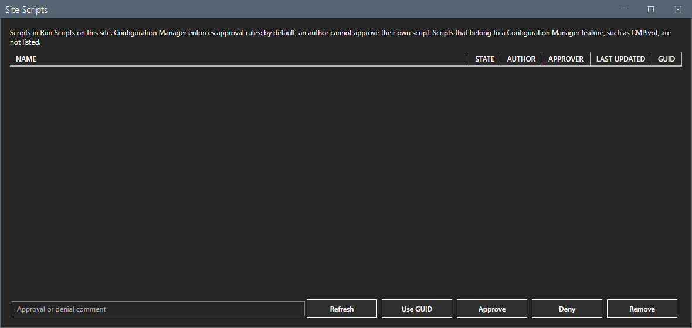
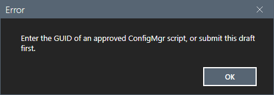
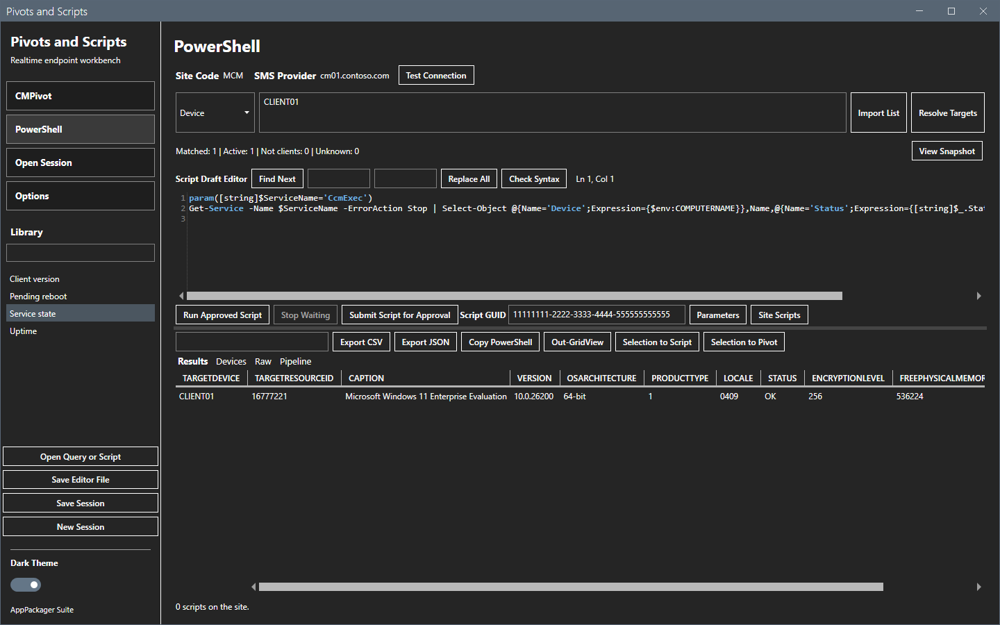
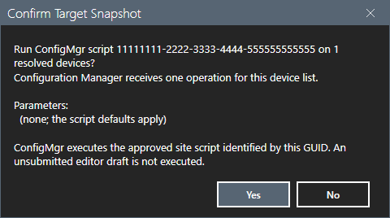
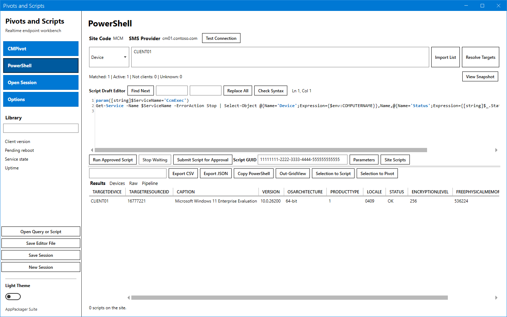

# Run Scripts

The PowerShell view runs a script that Configuration Manager has approved on the resolved devices. The tool also writes the draft, checks its syntax and submits it for approval.

## What it does

Run Scripts executes only approved site scripts. Configuration Manager enforces the approval rules. The tool never changes hierarchy settings. The run sends the script GUID and the parameter values. It does not send the text of the editor.

## When to use it

Use it for an action or a check that CMPivot cannot do, with a script that your approver accepted.

## Requirements

- Resolved targets. See [Targets](targets.md).
- The Configuration Manager console, and read access to the SMS Provider through WMI over DCOM, because the tool reads script results that way.
- The rights for each action. See [Permissions](../reference/permissions.md).

## Steps

### Open the PowerShell view

1. Select **PowerShell** in the sidebar. The heading changes, the run button reads **Run Approved Script**, and the controls **Submit Script for Approval**, **Script GUID**, **Parameters** and **Site Scripts** show.

2. Double-click a script in the **Library** list. The library holds the files of the `Library\Scripts` folder.

3. Select **Check Syntax**. The status line shows `PowerShell syntax valid.` with the number of parameters.

### Set the parameters

1. Select **Parameters**. The dialog `Script Parameters` shows one field for each parameter of the `param()` block, with its default value.

2. Change the values and select **Use Parameters**. Select **Cancel** to keep the old values.

### Submit the script for approval

1. Select **Submit Script for Approval**. A confirmation with the title `Create ConfigMgr Script` lists the parameters that the tool stores with the script.

2. Select **Yes** to create the script in Configuration Manager. The script then waits for approval.
3. Select **No** to stop. Nothing is created.

### Read, approve, deny or remove the site scripts

1. Select **Site Scripts**. The list shows the scripts of the site with the columns `Name`, `State`, `Author`, `Approver`, `Last Updated` and `GUID`. **Refresh** reads the list again.

2. Select a script. **Use GUID** puts its GUID in the **Script GUID** box. **Approve**, **Deny** and **Remove** change the script on the site, after a confirmation titled `Approve Script`, `Deny Script` or `Remove Script`. Type a comment in the box first for an approval or a denial.

By default, the site does not let an author approve or deny their own script. The status line shows the reason. Scripts of a Configuration Manager feature, such as the built-in CMPivot script, are not listed and cannot be changed.

### Run the approved script

1. Type the GUID of an approved script in **Script GUID**. Without a GUID, a message says so.

2. Select **Run Approved Script**. A confirmation with the title `Confirm Target Snapshot` lists the GUID, the number of devices and the parameter values.

3. Select **Yes** to run the script. See [Results](results.md) for the answers.

This guide selected **No** in the confirmations of **Submit Script for Approval** and of **Run Approved Script**. It did not submit, approve, deny, remove or run a script on the site. Those results were not checked. The list of site scripts was empty in the lab.

The light theme shows the same view. The light theme and the dark theme differ in colors only. Every blue box has white text in both themes.

## Options and settings of this page

| Control | Effect |
|---|---|
| **Check Syntax** | Checks the PowerShell syntax and counts the parameters. |
| **Submit Script for Approval** | Creates the script on the site. |
| **Script GUID** | Names the approved site script to run. |
| **Parameters** | Sets the values that the run sends. |
| **Site Scripts** | Lists, approves, denies or removes site scripts. |
| **Run Approved Script** | Runs the approved script on the targets. |
| **Options > Run Scripts > Approve scripts after submission** | Approves each new script right after **Submit Script for Approval**. See [Options dialog](options.md). |

## Limits

- Only string and integer parameters work. The site refuses switch parameters. **Submit Script for Approval** refuses switch, bool and other types.
- A value cannot contain a single quote. A script holds at most 10 parameters.
- The site drops values for names that it does not define. The tool refuses such names before the submission.
- A change of the text after the submission needs a new submission and a new approval.
- Script output is limited to 4 KB for each device. Return compact JSON with `ConvertTo-Json -Compress`.
- A script run times out on the site after one hour. The tool waits for 300 seconds for each device.

## Troubleshooting

| Message or symptom | Cause | Fix |
|---|---|---|
| `Enter the GUID of an approved ConfigMgr script, or submit this draft first.` | The GUID box is empty or not a GUID. | Type a GUID, or submit the draft. |
| `The draft changed after submission. Submit the edited script and obtain approval.` | You edited the text after the submission. | Select **Submit Script for Approval** again and get approval. |
| `Script <guid> (<name>) is not approved ...` | The script has no approval. | Get approval in Configuration Manager. |
| The status line gives the reason that the site refused a self-approval. | The site requires a second approver. | Ask a second approver, or allow self-approval in a lab. |
| `The parameters were set for different script text or another script GUID. Open Parameters again.` | The text or the GUID changed after you set the parameters. | Select **Parameters** again. |

## Links

- [Results](results.md)
- [Permissions](../reference/permissions.md)
