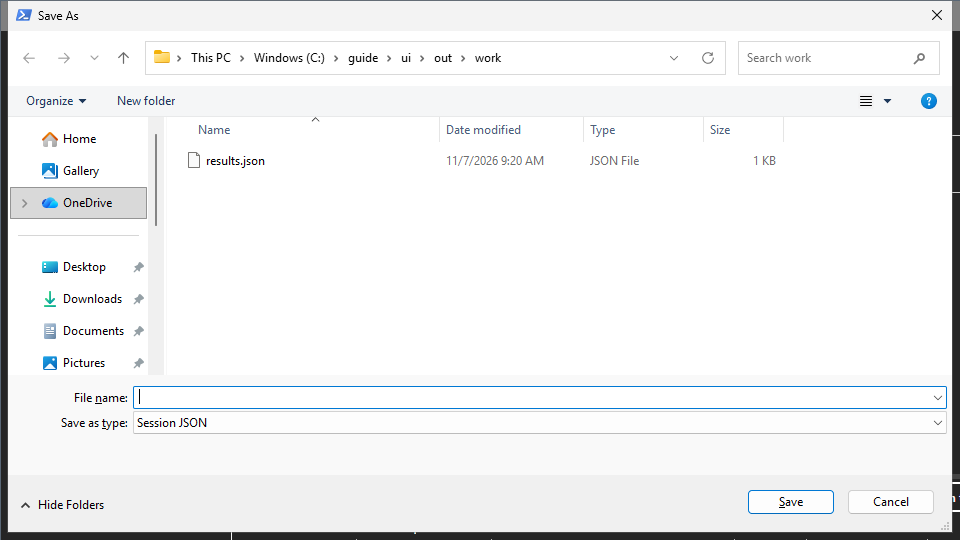
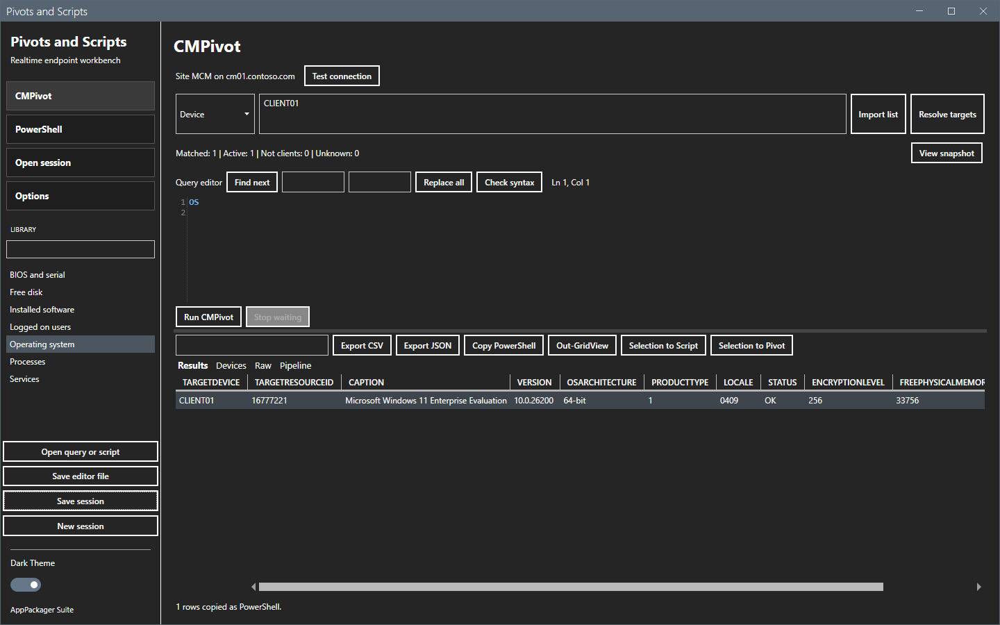
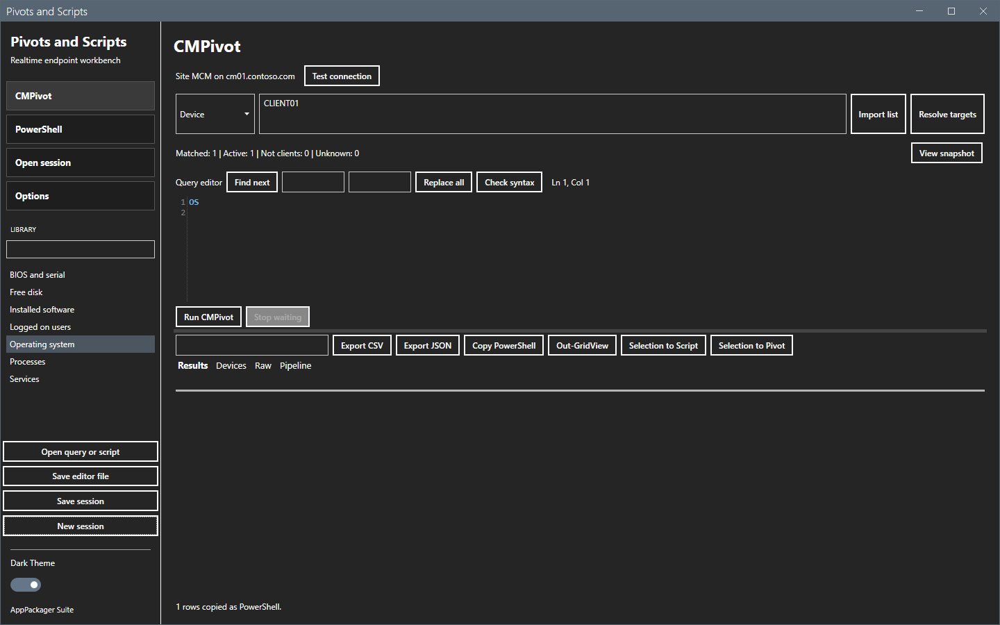
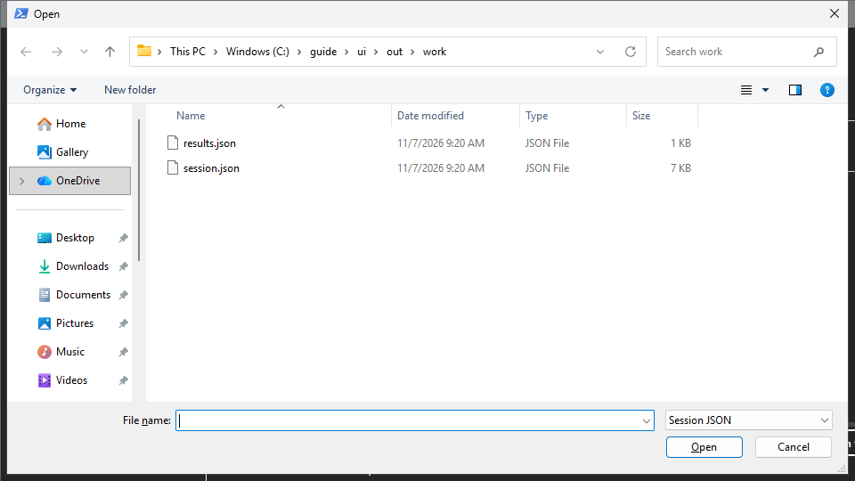
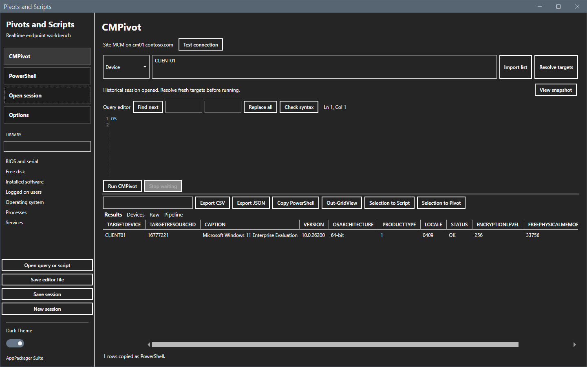
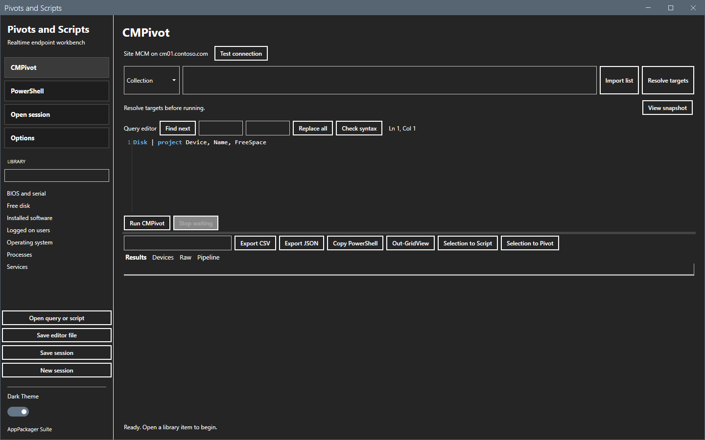

# Sessions

A session holds every step of your work: each run with its targets, its text, its parameters, the raw responses and the results.

## What it does

The tool saves the session before it sends the first operation of a run, and again when the run ends. You can save a copy to a file, open an earlier session file and start a new session.

## When to use it

Use it to keep the proof of what you sent and what came back, and to look at an earlier run.

## Requirements

None. A session needs at least one run to hold data.

## Steps

### Save a session to a file

1. Select **Save session**.
2. In the Save As dialog, pick a folder and a name, and select **Save**.

### Start a new session

Select **New session**. The tool saves the current session, clears the results and starts an empty session.

### Open an earlier session

1. Select **Open session** in the sidebar.
2. Pick a session file and select **Open**.

The tool shows the last step of the session: the mode, the text, the results, the device states and the raw records. The line under the target box says `Historical session opened. Resolve fresh targets before running.`

Open session does not run anything again.

### Reopen the tool

The tool saves the window position and size when you close it. The next start uses them.

## Options and settings of this page

| Control | Effect |
|---|---|
| **Save session** | Writes the session to a JSON file that you pick. |
| **New session** | Saves the current session and starts an empty one. |
| **Open session** | Reads a session file. |

## Limits

- The tool accepts only session files of schema version 1. Another file gives the message `Unsupported session file.`
- A run needs a history that the tool can write. When the save fails, the tool drops the new step and does not send the operation.
- The tool keeps no cleanup rule for old session files. See [Files and logs](../reference/files-and-logs.md).

## Troubleshooting

| Message or symptom | Cause | Fix |
|---|---|---|
| `Unsupported session file.` | The file is not a session file of this tool. | Pick another file. |
| `History save failed: ...` | The tool cannot write to its data folder. | Check the rights on the folder. |

## Links

- [Results](results.md)
- [Files and logs](../reference/files-and-logs.md)
