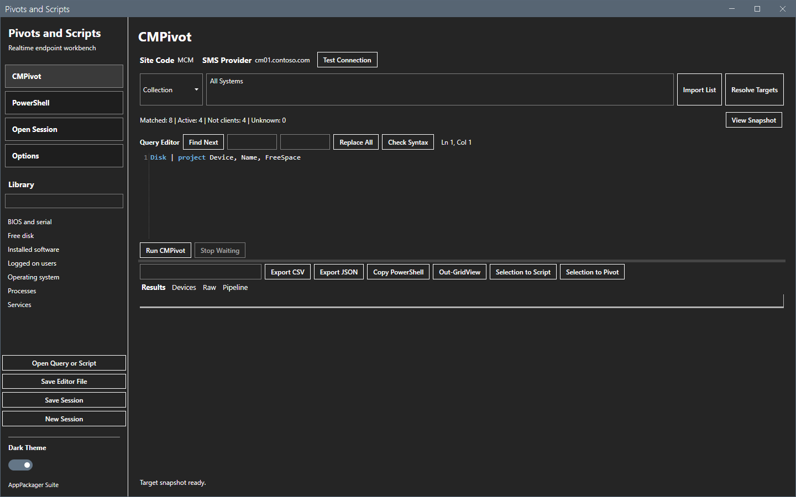
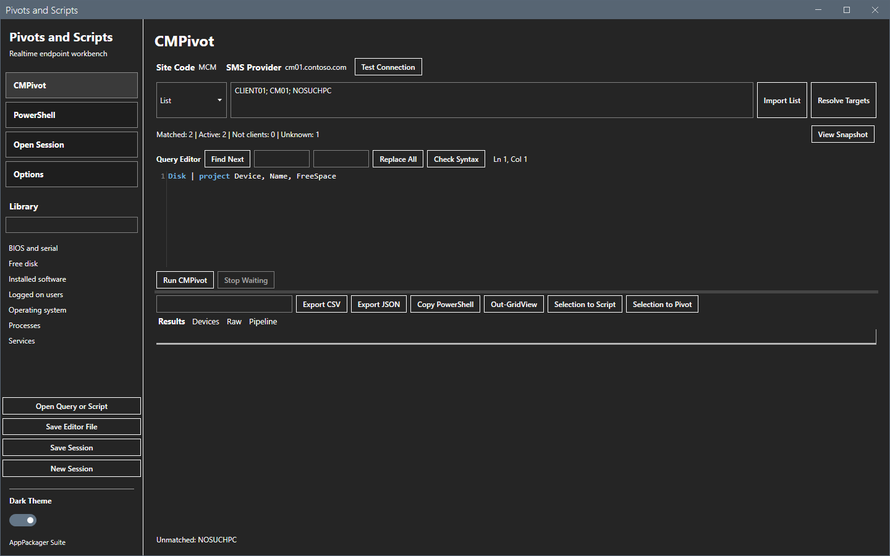
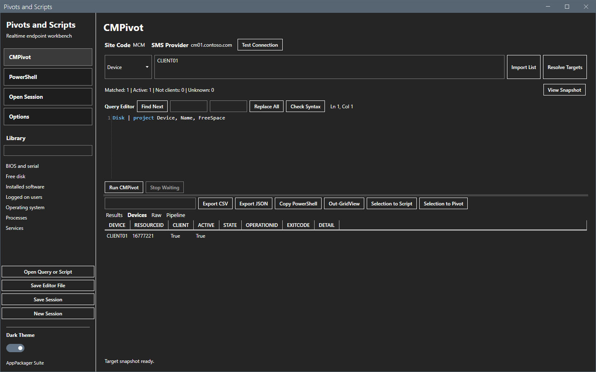
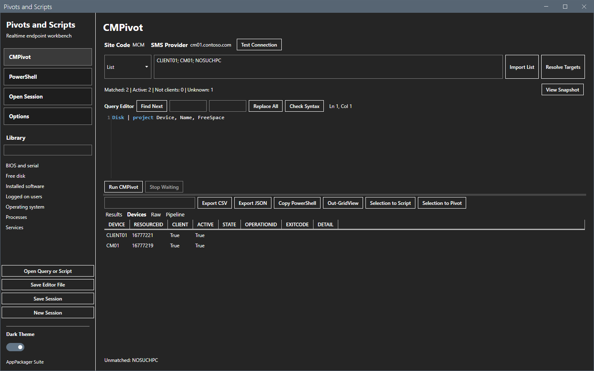
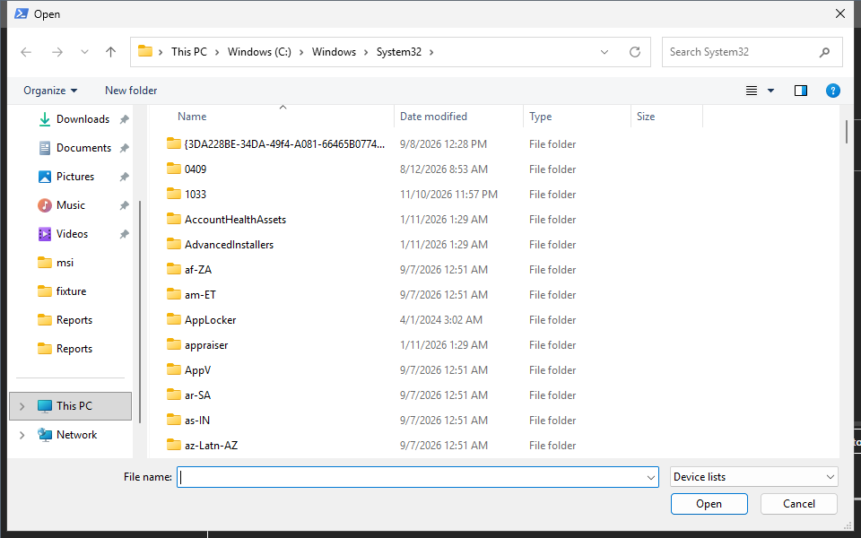
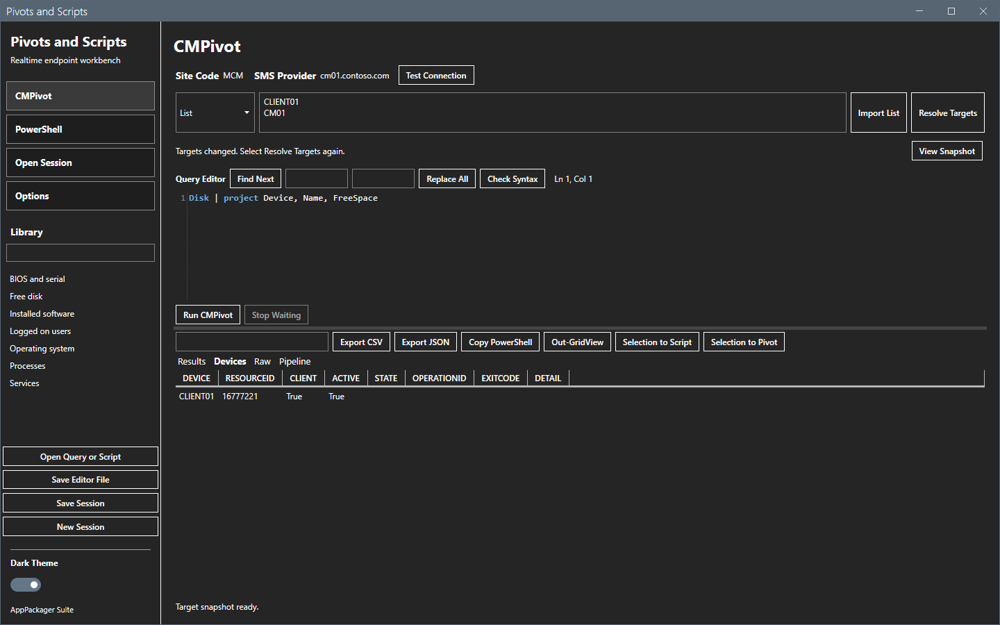
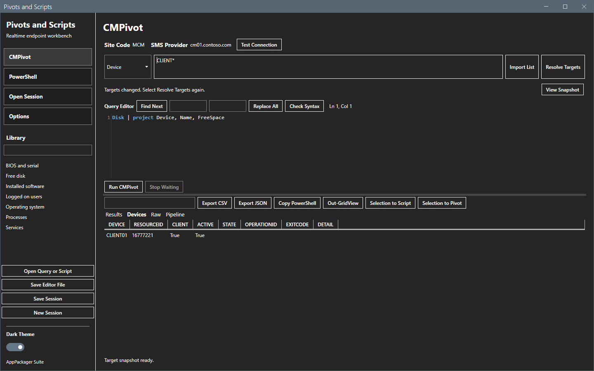

# Targets

The targets are the devices that a run goes to. You resolve them first. The tool then keeps the result as a fixed snapshot.

## What it does

It turns what you type into a list of devices, and shows how many devices match, how many are active and how many have no Configuration Manager client.

## When to use it

Use it before every run, and again after you change the connection or the target text.

## Requirements

- A connection that passes **Test Connection**. See [Getting started](../getting-started.md).
- The right to read devices and collections on the site.

## Steps

### Resolve targets

1. Select the kind in the list on the left of the target box: **Collection**, **Device**, **Pattern** or **List**.
2. Type the input in the target box. See the table below.
3. Select **Resolve Targets**.
4. Read the line under the box: `Matched`, `Active`, `Not clients` and `Unknown`.

| Kind | Input |
|---|---|
| Collection | A collection ID such as `SMS00001`, or the exact collection name. |
| Device | One device name. A wildcard character is a literal character. |
| Pattern | A device name with wildcards, for example `CLIENT*`. |
| List | Device names that you separate with commas, semicolons or line breaks. |

A name that does not exist in Configuration Manager counts as **Unknown**. The unknown names do not get a run. A device without a Configuration Manager client counts as **Not clients**. It shows **Not a client** at run time.

### Read the snapshot

Select **View Snapshot**. The tool opens the **Devices** tab.

### Import a list

1. Select **List** in the kind list.
2. Select **Import List**.
3. Pick a TXT file with one device name on each line, or a CSV file with a `Device` column.

The names fill the target box.

Select **Resolve Targets** to make the snapshot.

### Change the text

When you change the kind or the text, the snapshot is no longer valid. The line under the box says so. Resolve again before you run.

## Options and settings of this page

| Control | Effect |
|---|---|
| Kind list | Chooses Collection, Device, Pattern or List. |
| Target box | Holds the input. |
| **Import List** | Reads names from a TXT or CSV file. |
| **Resolve Targets** | Makes the snapshot. |
| **View Snapshot** | Opens the Devices tab. |

## Limits

- The snapshot is fixed until you resolve again.
- For a collection, the site sends the operation to the members at the time of the run. A device that joined after Resolve also answers and shows in the results.
- A CSV file without a `Device` column gives the message `CSV requires a Device column.`

## Troubleshooting

| Message or symptom | Cause | Fix |
|---|---|---|
| `Enter a target.` | The target box is empty. | Type a target. |
| `Collection '<name>' must resolve to exactly one device collection.` | No collection, or more than one, has that name or ID. | Use the collection ID. |
| `Connection changed. Select Resolve Targets again.` | You changed the connection after Resolve. | Select **Resolve Targets**. |
| `Select Resolve Targets first.` | You selected Run before you resolved. | Select **Resolve Targets**. |

## Links

- [CMPivot](cmpivot.md)
- [Run Scripts](run-scripts.md)
