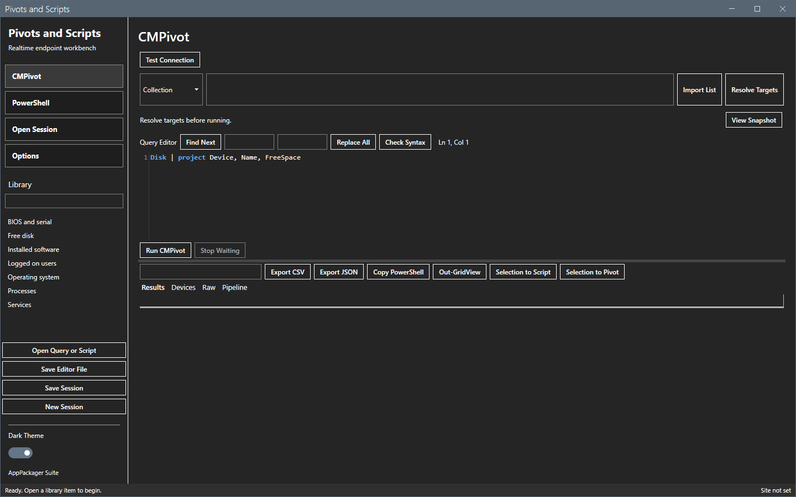
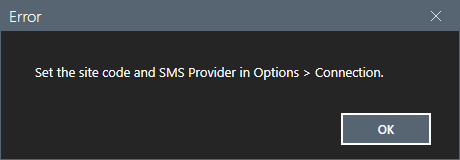
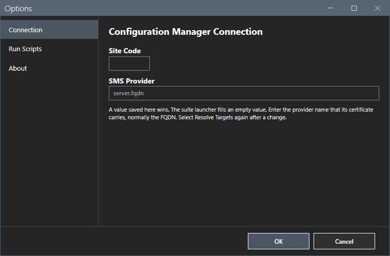
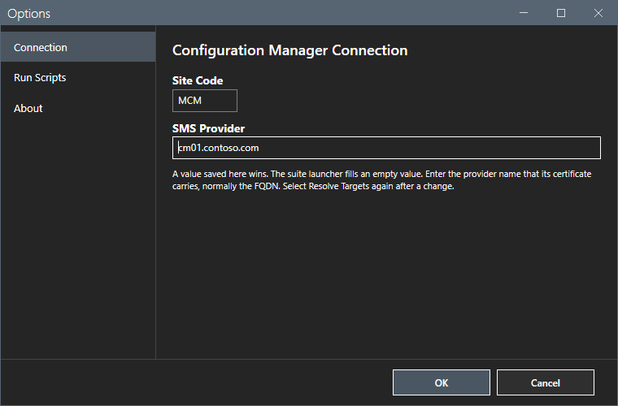
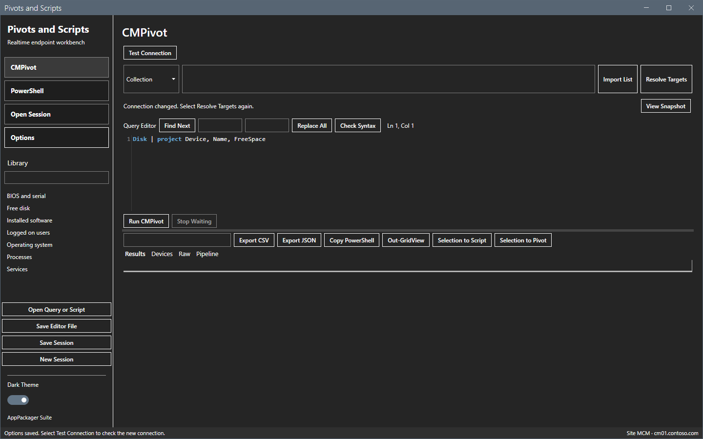
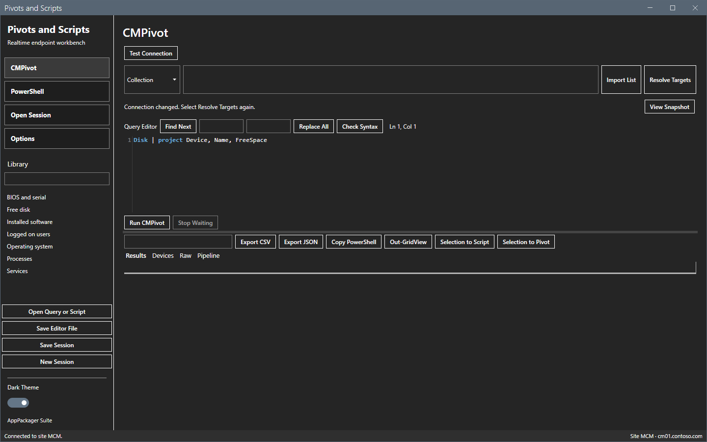
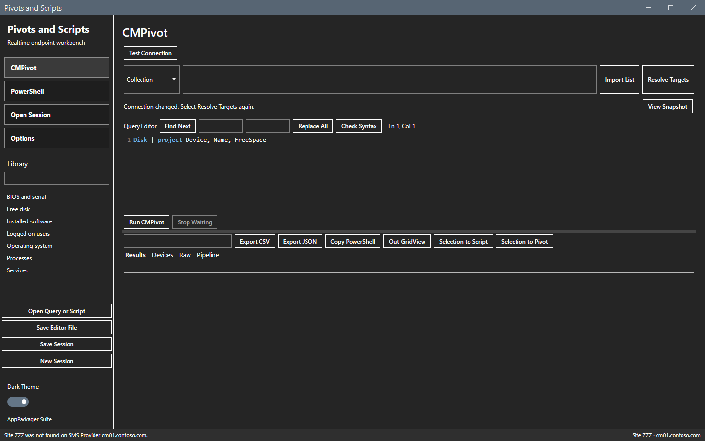
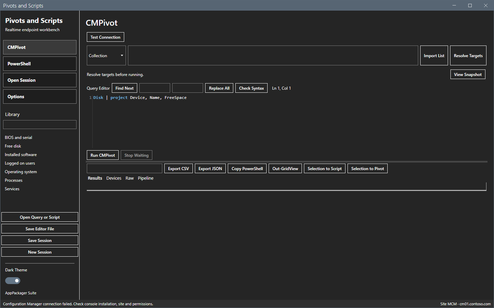

# Getting started

This page shows how to start Pivots and Scripts, set the connection and test it.

## What it does

The tool is a workbench for realtime device checks. You pick devices, send one CMPivot query or one approved script to them, and read the answers in a grid. Each run is saved with its targets, its text and its results.

## When to use it

Use it to ask many devices one question now, for example the free disk space, the logged-on users or the state of a service.

## Requirements

- Windows PowerShell 5.1 and .NET Framework 4.8.
- The Configuration Manager console on the same computer. The tool imports the `ConfigurationManager` module of the console. Without the console, **Test Connection** fails. See [Error messages](reference/error-messages.md).
- For CMPivot: the computer must trust the certificate of the SMS Provider. See [Permissions](reference/permissions.md) and [Network](reference/network.md).
- Rights on the site. See [Permissions](reference/permissions.md).

The tool uses your Windows account. It stores no password.

## Steps

### Start the tool

1. Extract the release zip to a folder that you can write to.
2. Double-click `Launch.cmd`. Or run this command:

```powershell
powershell.exe -NoProfile -STA -File .\start-pivotsandscripts.ps1
```

The window opens on the **CMPivot** view with a sample query. The footer says `Site not set`. Select it to open Options.



If you select **Test Connection** before you set the connection, a message tells you to open Options.



### Set the connection

1. Select **Options** in the sidebar.
2. Type the **Site Code**, for example `MCM`. A site code has 3 characters.
3. Type the **SMS Provider** name, for example `cm01.contoso.com`. Use the name that the certificate of the provider carries, normally the FQDN.
4. Select **OK**.





The footer shows the values at the right end: `MCM` and `cm01.contoso.com`, as `Site MCM · cm01.contoso.com`. Before you set them, the footer shows `Site not set`. The footer is read-only text. Select it to open **Options**. You change the site code and the SMS Provider only in **Options**.



### Test the connection

1. Select **Test Connection**. The status line shows `Working...`.


2. Wait for the status line to show `Connected to site MCM.`



If the provider does not host the site code, the status line says so.



### If the console is missing

On a computer without the console, **Test Connection** ends with a message in the status line. The test copy of this guide removed the module lookup to show it.



## Options and settings of this page

None. The settings are on [Options dialog](core/options.md).

## Limits

- The connection applies to the whole window. Resolve the targets again after a change.
- The command-line parameters `-SiteCode` and `-SMSProvider` override the saved values for one session.

## Troubleshooting

| Message or symptom | Cause | Fix |
|---|---|---|
| A message says `Set the site code and SMS Provider in Options > Connection.` | The site code or the provider is empty. | Set the connection. |
| The status line says `Site <code> was not found on SMS Provider <name>.` | The provider does not host that site code. | Correct the site code. |
| The status line says `Configuration Manager connection failed. Check console installation, site and permissions.` | The console is not installed, or the account has no right on the site. | Install the console. Check the account. |

## Links

- [Targets](core/targets.md)
- [Options dialog](core/options.md)
- [Troubleshooting](troubleshooting.md)
